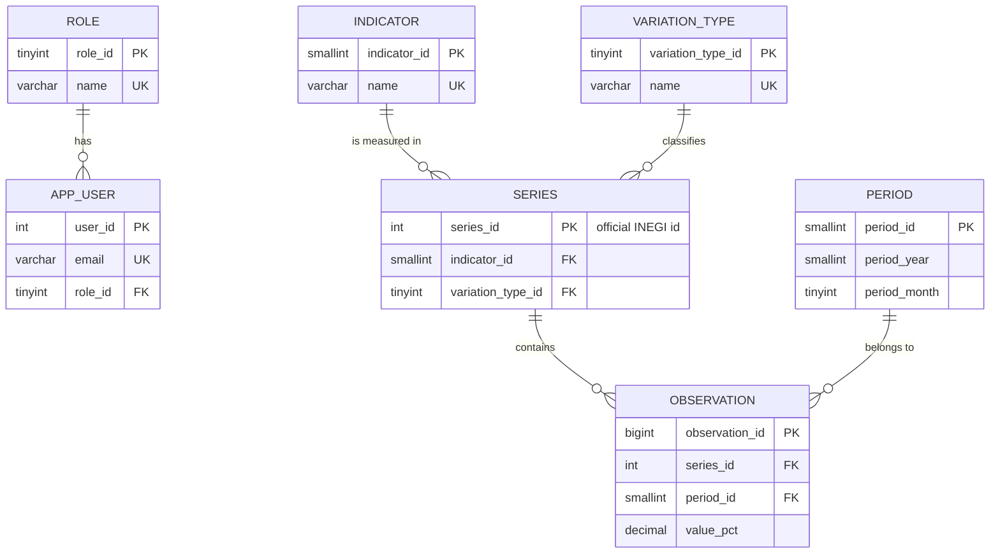

# Inflation in Mexico: Database System

A relational database (MySQL) with a MongoDB migration and a dashboard, built with the official
**INEGI** inflation data for Mexico.

**Author:** _Mendoza Leonel_ · **Course:** _Base de Datos Avanzada_ ·

---

## 1. Context

Inflation is the general and sustained increase in prices. In Mexico it is measured by INEGI through the
**National Consumer Price Index (INPC)**, and the central bank (Banco de México) targets an annual
inflation of **3 % ± 1 percentage point**.

This project takes the *"Monthly inflation"* file from INEGI's Economic Information Bank, **normalizes** it into a
relational database, and provides reports, role-based access control, automatic auditing and a MongoDB
copy that feeds a dashboard.

**Data:** 6 indicators × 3 variation types = 18 series, from January 2025 to October 2026
(393 valid observations). The original file is in `data/`.

| Indicator | What it measures |
|---|---|
| Headline CPI | Overall household inflation |
| Core | Inflation without the most volatile prices |
| Non-core | Agricultural products, energy and government tariffs |
| Minimum consumption basket | Goods and services of minimum consumption |
| Basic basket | Food and essential goods |
| PPI goods excl. oil | Producer prices, excluding oil |

---

## 2. Technologies

MySQL 8 + MySQL Workbench · Python 3 (PyMySQL, PyMongo, pandas) · MongoDB + Compass · Streamlit · Git/GitHub · PyCharm

---

## 3. Repository structure

```
mexico-inflation/
├── README.md
├── .gitignore
├── requirements.txt
├── config_example.py          <- copy it as config.py (passwords, NOT uploaded)
├── data/
│   └── INP_INP20261125012813.CSV     (original INEGI dataset)
├── sql/                       <- run in MySQL Workbench, in this order
│   ├── 01_create_database_and_tables.sql
│   ├── 02_functions.sql
│   ├── 03_views_reports.sql
│   ├── 04_stored_procedures.sql
│   ├── 05_audit_triggers.sql
│   ├── 06_roles_and_permissions.sql
│   └── 07_tests.sql
├── python/
│   ├── inegi_parser.py        <- "unpacks" the INEGI CSV
│   ├── load_data.py           <- CSV -> MySQL
│   ├── migrate_to_mongo.py    <- MySQL -> MongoDB + validation
│   └── dashboard.py           <- user interface (Streamlit)
└── docs/
    └── ER_diagram.png         (entity-relationship diagram exported from Workbench)
```

---

## 4. Data model (7 entities + audit table)



| # | Entity | Purpose |
|---|---|---|
| 1 | `role` | Application roles (Administrator, Analyst, User) |
| 2 | `app_user` | People who use the system |
| 3 | `indicator` | What is measured (Headline CPI, Core...) |
| 4 | `variation_type` | Monthly, Year to date, Annual |
| 5 | `series` | Each CSV column (indicator + variation type), with its INEGI id |
| 6 | `period` | One calendar month (the `period_date` column is generated automatically) |
| 7 | `observation` | The data point: value of a series in a period |
| - | `audit_log` | Change log filled by **triggers** |

### Normalization
The original CSV is a "wide" table (one column per series), which violates **1NF** (repeating groups).
- **1NF:** every cell is an atomic value; the 18 columns become rows of `observation`.
- **2NF:** `value_pct` depends on the whole key (`series_id`, `period_id`), not on part of it.
- **3NF:** indicator and variation-type names and descriptions live in their own tables; there are no transitive dependencies (the month name is computed, not stored).

---

## 5. Auditing with triggers
Nine triggers (`INSERT`, `UPDATE`, `DELETE` × `observation`, `indicator`, `app_user`) store in `audit_log`
the table, the operation, the **old** and **new** values (JSON), the MySQL user and the timestamp.
See `sql/05_audit_triggers.sql`.

## 6. Roles and permissions

| Role | Example user | Permissions |
|---|---|---|
| `role_administrator` | `admin_inflation` | Everything on the database |
| `role_analyst` | `analyst_inflation` | Reads data and views, runs queries, registers/corrects observations. Cannot delete or see users/audit log |
| `role_user` | `user_inflation` | Only reads the 3 report views and 3 basic queries |

## 7. Reports (views)
1. `vw_report_annual_inflation`: annual inflation per indicator with a classification against Banxico's target.
2. `vw_report_indicator_summary`: average, minimum and maximum monthly inflation per indicator.
3. `vw_report_core_vs_noncore`: headline, core and non-core inflation side by side, with the gap between them.

(All of them are built on the base view `vw_inflation_detail`.)

## 8. Functions and stored procedures
- **Functions:** `fn_classify_inflation(value)`, `fn_real_value(amount, inflation)`.
- **Queries:** `sp_list_indicators`, `sp_get_by_period`, `sp_get_history`, `sp_get_latest_inflation`, `sp_top_inflation_months`, `sp_purchasing_power`.
- **Validated writes:** `sp_register_observation`, `sp_update_observation`, `sp_delete_observation`.
- **For the migration:** `getAllRole`, `getAllApp_user`, `getAllIndicator`, `getAllVariation_type`, `getAllSeries`, `getAllPeriod`, `getAllObservation`, `getAllAudit_log`.

## 9. MongoDB migration
`python/migrate_to_mongo.py` does three things:
1. **Migrates every table** to a collection (calling the `getAll...` procedures).
2. **Builds its own NoSQL structure:** the `inflation_by_period` collection with **one document per month** and the indicators nested inside:
   ```json
   { "year": 2026, "month": 10,
     "indicators": { "Headline CPI": { "monthly": 0.65, "ytd": 2.79, "annual": 3.75 }, "...": {} } }
   ```
   It is nested because the dashboard always needs all the indicators of a month together (one query, no JOINs).
3. **Validates** that row counts per table and the sum of `value_pct` match between MySQL and MongoDB.

## 10. Interface
`streamlit run dashboard.py` opens a dashboard with: latest-month summary, trend, the 3 reports,
a purchasing-power calculator and the audit log. It reads **from MongoDB**.

## 11. Data quality
The CSV contains 3 `N/E` values (data not available) for the PPI in August 2025. The loader **skips** them
instead of storing them as text, which is why there are 393 observations and not 396 (18 series × 22 months).

## 12. How to run it
1. Install MySQL 8 + Workbench, MongoDB + Compass, Python 3, then `pip install -r requirements.txt`.
2. Copy `config_example.py` to `config.py` and type your password.
3. Workbench: run `sql/01_create_database_and_tables.sql`.
4. Terminal (`python/` folder): `python load_data.py`.
5. Workbench: run `sql/02` → `03` → `04` → `05` → `06`.
6. Terminal: `python migrate_to_mongo.py`.
7. Terminal: `streamlit run dashboard.py`.

## 13. Data source
INEGI. *National Consumer Price Index, base second half of July 2018 = 100. Basket and weights update 2024.* Retrieved on 25/11/2026.
